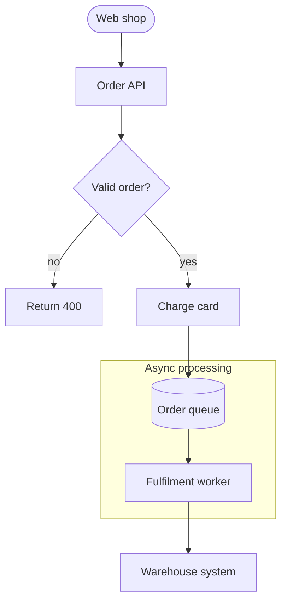
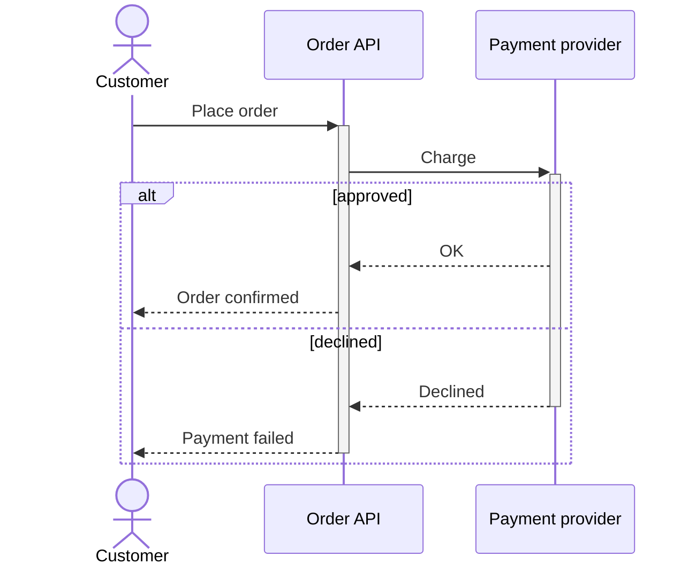
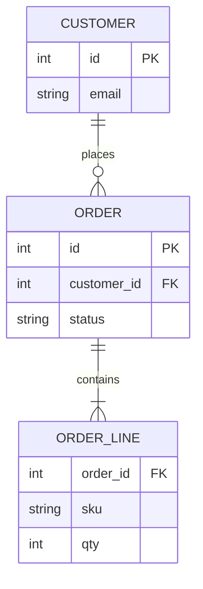
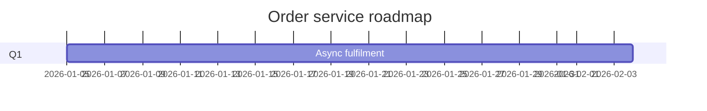

# Order service architecture

The order service accepts orders from the web shop, charges the customer and
hands paid orders to the warehouse.

## Request flow

## Checkout

## Data model

## Roadmap

